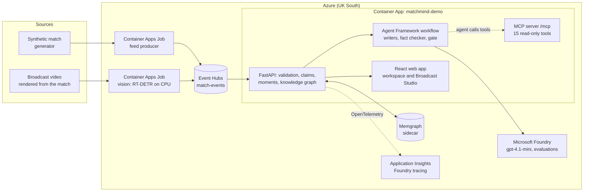

# Pitchlight

*Formerly MatchMind. Some Azure resource names and settings (`MATCHMIND_*`) keep the old name; the old demo address redirects here.*

**AI football commentary you can put on air: every statement is verified before anyone sees it.**

Broadcasters, studios and fan apps want AI that explains a match live, in any language. They cannot put it on screen, because language models invent scorers, results and causes. Pitchlight lets agents write and **code verify**: a fact-checking agent extracts every statement, plain code checks each one against the match events, and anything unsupported is sent back or blocked. Nothing unverified is published.

- **Proven live:** 21 of 21 agent-written recaps published across 7 languages; 0 unsafe passes in 264 live fact checks; Microsoft Foundry groundedness 4.71 / 5.
- **Ready for real data:** checked offline on 2,669 real matches from two providers, with every score matching (the product itself runs on synthetic data).
- **Built on Azure:** Microsoft Foundry and Agent Framework agents that use Pitchlight's own MCP tools, Event Hubs, Container Apps, Azure AI Speech, managed identity throughout.

**See it in 60 seconds:** open the demo, choose **See it in 60 seconds**, and in **Try to fool the fact checker** type a false claim (for example *"Calderbrook won thanks to a hat-trick"*). Then press **AI recap** and open the run to see every statement with its verdict.

| | |
| --- | --- |
| **Live demo** | https://pitchlight.mangograss-8c9a0131.uksouth.azurecontainerapps.io (no sign-in, read-only, synthetic data) |
| **Video (1:46, narrated)** | [docs/demo/pitchlight-submission.mp4](docs/demo/pitchlight-submission.mp4) |
| **MCP server** | `https://pitchlight.mangograss-8c9a0131.uksouth.azurecontainerapps.io/mcp` |
| **Submission** | [docs/SUBMISSION.md](docs/SUBMISSION.md): pitch, category and testing instructions |

All clubs (Calderbrook FC, Merridge Athletic), players and events are fictional and synthetic. Pitchlight is not affiliated with the Premier League.

## What makes it different

1. **Auto-eventing from video, scored against perfect ground truth.** Pitchlight renders its synthetic match as broadcast video. A vision pipeline then recovers players, ball, passes, goals and speeds from the pixels alone: pitch-line camera calibration, RT-DETR player detection, team and identity tracking, and ball tracking. Real footage has no exact labels; synthetic video does, so every stage is measured:

   | Stage | Result |
   | --- | --- |
   | Camera calibration | 3 cm |
   | Players detected | 87% |
   | Team / identity | 98% / 79% |
   | Events | 87.5% precision, goal found |
   | Pass speed | within 2.6 km/h |

   It runs as an Azure Container Apps Job that streams the recovered events through Event Hubs into the live app. See [VISION.md](docs/VISION.md).
2. **Agents that investigate, write and check one another.** Each recap starts with a researcher agent that decides which of Pitchlight's MCP tools to call and chooses the angle; code turns its choices into facts. A Microsoft Agent Framework workflow then writes narratives and recaps, and a fact-checking agent extracts every statement for **code** to verify, in any of 7 languages. Live results: 0 unsafe passes in 264 checks, and 21 of 21 live recaps across 7 languages published, with the researcher choosing each angle. Under every AI recap, the run is visible step by step: each agent's draft and every statement with code's verdict.
3. **Agents that use tools through MCP.** Pitchlight serves its verified match intelligence as an MCP server with 15 read-only tools. A Foundry agent answers viewers' questions by calling those tools, so the answer shown is the tool's verified result, never the model's own text. Copilot, Claude Desktop or any other MCP client can use the same tools.
4. **A knowledge graph of everything verified.** It links events, possessions, players, moments and claims. It powers "Why this moment?", pass-network roles (hub, key link, PageRank), xG chain, goal build-ups, and the impact of a correction on every output. It is mirrored in a Memgraph database, and its parity with NetworkX is tested on real Memgraph and Neo4j.
5. **Tactical change, explained honestly.** For every substitution and red card Pitchlight compares the ten minutes before and after. It covers attacking output, pressing (PPDA, high turnovers), defensive shape from tracking (line height, width, compactness) and pass-network shifts. Each swing is ranked against the match's own swings, and the wording never claims a cause. See [TACTICS.md](docs/TACTICS.md).
6. **Built on synthetic data, ready for real data.** The product, the demo and every test run on synthetic data, as the brief requires. To show the path to production, a provider adapter was checked offline against public StatsBomb open data: across **all 64 matches of the 2022 World Cup**, 81,931 events were accepted and 0 rejected, and every score matched the official result, including 5 matches with extra time and 3 own goals. On the final, the tactical analysis picks out France's 41′ double substitution as the turning point, where possession swung from 80% Argentina to 64% France. A second integration reads Sportmonks records: across 2,605 real matches of three seasons, every score matched the official result, with 193 own goals and 47 penalty shootouts handled. No provider data is stored in this repository. See [PROVIDERS.md](docs/PROVIDERS.md).
7. **Measured, end to end.** Foundry evaluations (groundedness 4.71/5, no unsupported numbers), live fact-check holdouts, ground-truth vision scores, about 270 backend tests, browser tests against the live site, and CI on every push.

## The pipeline

The brief's five stages, live:

1. **Ingest.** Events arrive one at a time through **Azure Event Hubs**, from the data feed or recovered from video. Each event is validated against the stream so far; duplicates are skipped and bad events reported.
2. **Interpret.** Team and player statistics; pass difficulty; ball and shot speed; speed and distance; control vs chaos; tempo; momentum; and the knowledge graph.
3. **Explain.** Every moment says why it matters: an opener, an equaliser, "down to ten", a new key link, momentum. **Why?** opens the build-up, the players' network roles and the evidence.
4. **Render.** Timed, machine-readable overlays in Broadcast Studio, ready for a rendering partner, including Arabic right-to-left.
5. **Personalize.** Fan, analyst or broadcast mode; favourite club and players; follow one player; track one metric; 7 languages. The facts stay the same; the selection, emphasis and language change.

## Architecture



Every Azure call uses **managed identity**; no keys are stored anywhere. Production mode is **release-gated** until the controls in [PATH_TO_PRODUCTION.md](docs/PATH_TO_PRODUCTION.md) are in place.

## Microsoft and Azure technology

| | Used for |
| --- | --- |
| **Microsoft Foundry** | `gpt-4.1-mini` for every agent; release evaluations with Azure AI Evaluation; tracing of agent, model and MCP tool calls. See [FOUNDRY.md](docs/FOUNDRY.md). |
| **Microsoft Agent Framework** | The multi-agent workflow (typed executors, conditional edges, handoffs, retries, fallback) and the MCP-calling Q&A agent. See [AGENT_WORKFLOW.md](docs/AGENT_WORKFLOW.md). |
| **Model Context Protocol** | 15 read-only, time-scoped match tools at `/mcp` and over stdio; `.vscode/mcp.json` for GitHub Copilot agent mode. See [MCP.md](docs/MCP.md). |
| **Azure Container Apps** | The API and web app, with a Memgraph sidecar |
| **Azure Container Apps Jobs** | The feed producer, and the vision job that turns broadcast video into events |
| **Azure Event Hubs** | The live match feed: Entra ID only (SAS disabled), ordered per match, carrying the data feed and events recovered from video. See [EVENT_DRIVEN.md](docs/EVENT_DRIVEN.md). |
| **Application Insights / OpenTelemetry** | Traces, connected to the Foundry project |
| **Azure Container Registry (Tasks)** | Image builds, and real Memgraph and Neo4j integration tests |
| **Managed identity and Azure RBAC** | Foundry, Event Hubs, Azure Resource Manager (starting jobs), the registry |
| **GitHub Actions** | CI on every push: core and agent-SDK backend suites, frontend build |

## Try it in two minutes

On the [live demo](https://pitchlight.mangograss-8c9a0131.uksouth.azurecontainerapps.io/app):

1. Watch **Your moments** fill in as the match replays, then press **Why?** on a goal.
2. In **Your view**, switch the language to Arabic, the mode to Analyst, and follow a player.
3. **Ask the match** "Who is Merridge's key player?". The answer is labelled *Foundry agent via MCP*.
4. Open **Video AI** in the sidebar and play the clip: these are detections from the pixels, compared live with the truth.
5. Open **Live data → Kick off a live match** to stream a match through Event Hubs. **Analysis** has the explorable pass network and team statistics. Lanes are directed and forward lanes highlighted. Click a player for their passing partners or a lane for its evidence, and use *Show change* to compare with the previous 15 minutes.

## Repository map

| Path | What it holds |
| --- | --- |
| `backend/app/core.py`, `live.py`, `feed.py` | Event model, stream validation, the live pipeline, the Event Hubs consumer and producer |
| `backend/app/claims.py`, `moments.py`, `dynamics.py`, `players.py` | Typed claims, key moments and why they matter, control/chaos/momentum, player statistics |
| `backend/app/knowledge.py`, `graph/` | Match knowledge graph, NetworkX analytics, Memgraph/Neo4j projection |
| `backend/app/agents.py`, `agent_workflow.py`, `ask.py`, `mcp_server.py` | Foundry runtime, multi-agent workflow and fact checker, Ask the match, MCP server |
| `backend/app/tactics.py`, `backend/app/providers/` | Tactical change impact, pressing and shape; provider adapters (StatsBomb) |
| `backend/app/tracking.py`, `backend/vision/` | Ground-truth tracking; the vision pipeline, its scorer and its Azure publisher |
| `backend/evaluation/` | Offline evaluation, live fact-check holdouts, Foundry release evaluation |
| `frontend/src/` | Workspace, Broadcast Studio, graph explorer, vision panel; `render.html` is the broadcast renderer |
| `docs/` | Design and verification documents (index: [docs/README.md](docs/README.md)) |

## Run it locally

```bash
# backend (Python 3.12)
cd backend
python -m venv .venv-agents && .venv-agents/Scripts/python -m pip install -r requirements-agents.txt
.venv-agents/Scripts/python -m uvicorn app.main:app --port 8000

# frontend (Node 22)
cd frontend && npm ci && npm run dev    # http://localhost:5173
```

Without Azure settings, everything except the model-written text works offline, using verified templates. To use Foundry, copy `backend/.env.example` to `backend/.env`, set the project endpoint and deployment, and run `az login`. The vision pipeline has its own environment; see [VISION.md](docs/VISION.md).

## Tests and evaluation

| Suite | Command | Result |
| --- | --- | --- |
| Backend | `cd backend && python -m pytest -q` | 300 passed with the agent SDK; the core-only suite also runs in CI |
| Vision | `.venv-vision/Scripts/python -m pytest tests/test_vision.py` | 7 passed: geometry, calibration from lines, teams, events, validation |
| Real graph databases | [graph-db-tests.yaml](backend/graph-db-tests.yaml) in ACR Tasks | Memgraph and Neo4j parity with NetworkX |
| Browser | `cd frontend && npx playwright test` (also against the live URL) | 7 passed |
| Foundry release evaluation | `backend/evaluation/foundry_eval.py` | groundedness 4.71/5, 0 unsupported numbers ([report](foundry-eval-report.json)) |
| Vision vs ground truth | `python -m vision.run` | [vision-report.json](vision-report.json) |

## Documentation

Start with the [documentation index](docs/README.md). Key documents: [Brief coverage](docs/HACKATHON_COVERAGE.md) · [Auto-eventing from video](docs/VISION.md) · [Tactical changes](docs/TACTICS.md) · [Real data providers](docs/PROVIDERS.md) · [Agent workflow](docs/AGENT_WORKFLOW.md) · [Foundry](docs/FOUNDRY.md) · [MCP](docs/MCP.md) · [Event-driven feed](docs/EVENT_DRIVEN.md) · [Knowledge graph](docs/GRAPH_INTELLIGENCE_ARCHITECTURE.md) · [Deployment](docs/DEPLOYMENT.md) · [Path to production](docs/PATH_TO_PRODUCTION.md)

## Licence

MIT. See [LICENSE](LICENSE). The Microsoft Rocketbox player models are MIT-licensed and credited separately.
